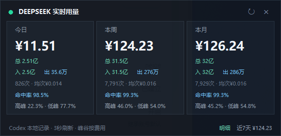
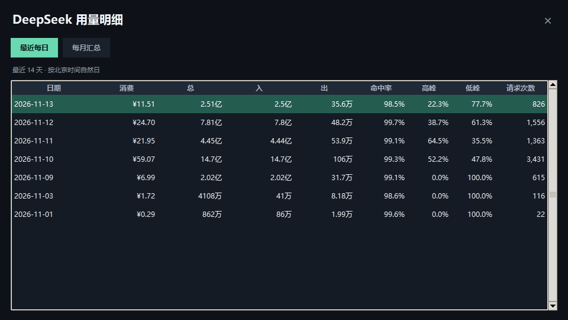

# Codex DeepSeek 用量监控

一个运行在 Windows 上的 Codex 桌面伴随插件，用于实时查看 DeepSeek API 的费用与 Token 用量。

<p align="center">
  
</p>





## 功能介绍

- 显示带今日消费金额的动态桌面小玩偶。
- 鼠标停留后展开今日、本周和本月汇总。
- 支持查看每日和每月明细。
- 分别显示总量、输入和输出 Token。
- 显示缓存命中率、高峰与低峰费用占比。
- 内置 DeepSeek 历史价格和 2026 年中国法定节假日。
- 增量读取本地 Codex 会话记录，并使用 SQLite 缓存统计结果。
- 支持多显示器定位、自由拖动和屏幕边缘吸附。
- 跟随 ChatGPT/Codex 启动，并支持异常退出后自动恢复。

插件不会保存 DeepSeek API Key。所有统计均来自本地 Codex 会话记录，并通过
`plugins/deepseek-usage-monitor/skills/deepseek-usage-monitor/scripts/pricing.json`
中的价格配置计算费用。

## 运行要求

- Windows 10 或 Windows 11
- Codex 桌面端
- Python 3.10 或更高版本，并包含 Tkinter
- 建议安装 7-Zip，用于读取压缩后的 Codex 会话日志

建议安装压缩日志解析依赖：

```powershell
python -m pip install -r requirements.txt
```

如果没有安装 `zstandard`，插件会依次尝试：

1. 环境变量 `DEEPSEEK_7ZIP_PATH` 指定的 7-Zip 路径
2. 系统 `PATH` 中的 `7z.exe` 或 `7zz`
3. `Program Files` 下的标准 7-Zip 安装目录

## 安装

克隆仓库并添加为本地 Codex 插件市场：

```powershell
git clone https://github.com/ascendzjb/codex-deepseek-usage-monitor.git
cd codex-deepseek-usage-monitor

codex plugin marketplace add .
codex plugin add deepseek-usage-monitor@deepseek-usage-monitor
```

安装后请完全退出并重新打开 ChatGPT/Codex 桌面端，以刷新插件列表。

如需读取压缩会话但不使用 7-Zip，可先执行：

```powershell
python -m pip install -r requirements.txt
```

## 使用方法

直接启动悬浮玩偶：

```powershell
powershell.exe -NoProfile -ExecutionPolicy Bypass `
  -File ".\plugins\deepseek-usage-monitor\skills\deepseek-usage-monitor\scripts\start_widget.ps1"
```

- 按住小玩偶或今日消费徽章即可拖动。
- 拖到屏幕边缘附近并松开，会自动吸附。
- 鼠标停留约 0.65 秒后展开用量面板。
- 点击“明细”查看每日和每月数据。
- 手动关闭后，监听器不会反复拉起；下次启动 ChatGPT/Codex 时会自动恢复。

创建桌面快捷方式和登录自启动项：

```powershell
powershell.exe -NoProfile -ExecutionPolicy Bypass `
  -File ".\plugins\deepseek-usage-monitor\skills\deepseek-usage-monitor\scripts\create_shortcuts.ps1"
```

## 统计范围

- 消费金额是根据本地 Codex 会话记录计算的估算值。
- 不包含其他设备或其他应用使用同一 API Key 产生的费用。
- 不包含 DeepSeek Search 和 Fetch 按请求次数产生的费用。
- 未识别的模型或价格时段会标记为“未计价”，不会静默套用其他模型的价格。

## 开源协议

本项目使用 MIT License，可以下载、修改、分发和二次发布。
